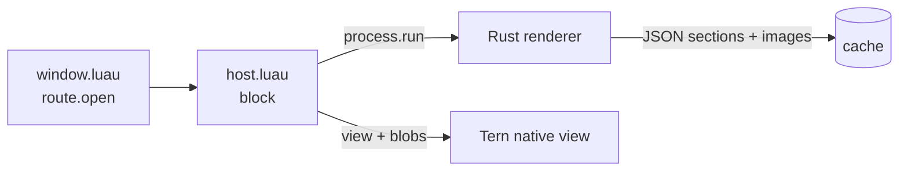

# Office Preview — a Tern plugin

**English** | [简体中文](README.zh-CN.md)

Preview Word (`.docx`) and Excel (`.xlsx`) files natively inside the Tern terminal. No Office, no browser, no LibreOffice — a small Rust renderer turns documents into Tern's native views, with styles, tables, merged cells, number formats, images and equations.

## Highlights

- **Just open it** — click in the file panel, `tern open report.docx`, click a path in the terminal, or drag from Finder.
- **Word**: style inheritance, themes, CJK font fallback, multi-level numbering, nested tables, images, text boxes, footnotes, headers/footers, tracked changes, equations (OMML → TeX), clickable table of contents.
- **Excel**: real Excel number formats (dates, currency, `[Red]`, fractions, the 1900 leap-year bug…), merged cells, text overflow, hidden rows/cols, frozen header rows, sticky row/column headers, multiple sheets.
- **Spreadsheet selection like Office** — click cells / rows / columns, arrow keys, crosshair highlight (`h`), copy cell (`y` / `⌘C`).
- **Fast** — on Apple Silicon: 50k × 20 xlsx in 0.17s, 300-page docx in 0.08s. Results are cached; reopening is instant.
- **Cross-platform** — prebuilt renderers for macOS (universal), Linux x86_64/aarch64 (musl static), Windows x86_64.

Supported extensions: `docx docm dotx dotm xlsx xlsm xltx xltm`.

## Install

**Recommended — release package (prebuilt renderer, no Rust needed):**

Download `office-preview-<version>.tar.gz` from [Releases](https://github.com/zerx-lab/tern-office-preview/releases), then:

```sh
tar -xzf office-preview-0.2.0.tar.gz
tern plugin install ./office-preview
```

**From source (needs `cargo`; renderer builds automatically on first open):**

```sh
tern plugin install https://github.com/zerx-lab/tern-office-preview
```

## Keys

| Key | Action |
| --- | --- |
| `]` / `[` | Next / previous section |
| `}` / `{` (`Tab` / `⇧Tab`) | Next / previous sheet |
| `+` / `-` / `0` | Zoom in / out / reset (50%–200%) |
| `o` | docx: toggle table of contents |
| `h` | xlsx: toggle crosshair highlight |
| `y` / `⌘C` | Copy selected cell |
| `r` | Reload |
| `b` | Rebuild renderer |

## Not supported (yet)

Charts (placeholder shown), SmartArt, EMF/WMF, conditional formatting, comments, shapes, legacy `.doc` / `.xls`, encrypted files, `.pptx`.

## How it works



Tern plugins are Luau with no zlib and a 2s budget per call, so parsing is offloaded to a Rust CLI. Output is Tern's HTML-subset nodes; tables are emitted as CSS grid (Tern's table layout ignores `colspan`/`rowspan`), and arbitrary colors/sizes map onto a generated utility-class stylesheet since inline styles aren't supported. Full design notes: [README.zh-CN.md](README.zh-CN.md).

## Development

```sh
cd native && export CARGO_TARGET_DIR=/tmp/office-preview-target
cargo test
cd .. && python3 tests/run.py
scripts/package.sh            # build release packages for all platforms into ../dist/
```

## License

MIT
