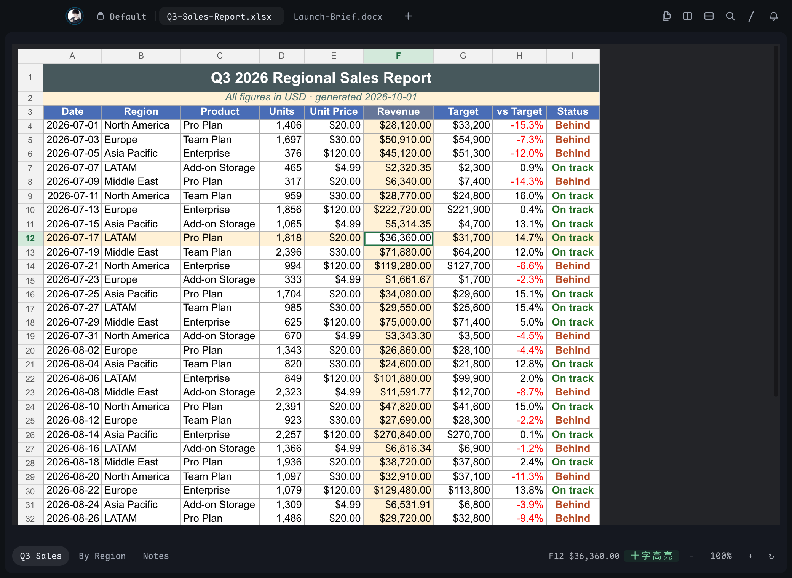
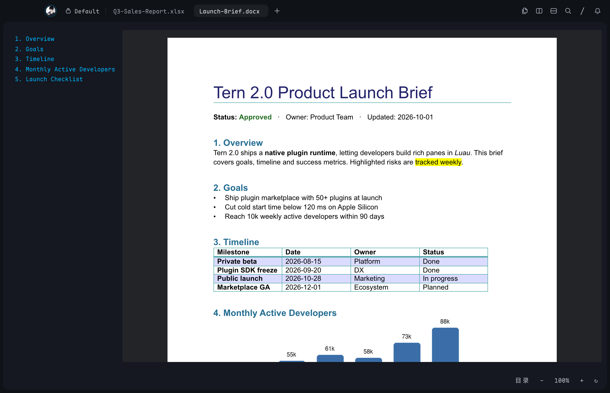
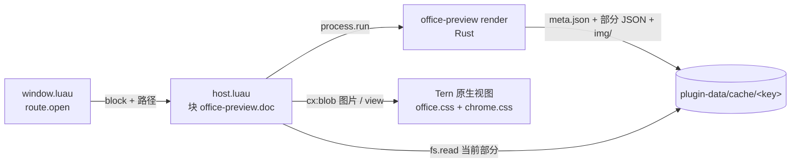

# Office 预览（Tern 插件）

在 Tern 里原生预览 Word（`.docx`）和 Excel（`.xlsx`）文件。插件把样式、表格、合并单元格、数字格式、图片和公式都画成 Tern 原生视图，不调用外部 Office 或浏览器。





- **打开方式**：在文件面板里点击，或在命令面板「Open file…」里打开、在终端里点击路径、从 Finder 拖入，或运行 `tern open 报告.docx`。这些入口都会进入预览块（`tern.route.open`）。文件右键菜单里也有「Open with Office 预览」。
- **支持的扩展名**：`docx docm dotx dotm xlsx xlsm xltx xltm`。Office 的锁文件（`~$*.docx`）不会被接管。

## 安装

**普通用户：安装发布包（已带预编译渲染器，不需要 Rust）**

```sh
tar -xzf office-preview-0.2.0.tar.gz          # 或解压 .zip
tern plugin install ./office-preview           # 也可以放到 git 仓库根目录，再用 tern plugin install <git url> 安装
```

发布包里的 `bin/` 包含 macOS（arm64 和 x86_64 合并的通用二进制）、Linux x86_64 和 aarch64（musl 静态链接）、Windows x86_64 的渲染器。插件按 `tern.runtime.os` 选择对应的程序；在 Linux 上，CPU 架构通过读取 `/bin/sh` 的 ELF 头判断。如果预编译的程序无法启动（比如解压后丢了可执行权限，或者浏览器下载的压缩包带有 macOS 隔离标记，被 Gatekeeper 拦下），插件会把它复制到插件数据目录、加上可执行权限后再试一次。

**开发：链接源码目录，渲染器从源码编译**

```sh
tern plugin link /path/to/tern-plugins/office预览
office预览/scripts/build.sh          # 可选：提前构建，安装到 <state>/plugin-data/office-preview/bin/
```

源码目录里没有预编译程序。第一次打开文档时插件会自动编译（需要 `cargo`，约半分钟到几分钟，取决于依赖下载），之后打开文档是秒级的。构建产物放在插件数据目录（`TERN_PLUGIN_DATA`）中，不会写进插件目录：Tern 监视插件目录，目录一有变化就会重载插件。`native/Cargo.toml` 的版本号变化后，插件会认为已有的二进制过期了，下次打开文档时自动重新构建。按 `b` 可以强制重新构建。

渲染器的选用顺序：先用数据目录里版本相符的构建，再用发布包附带的预编译程序，都没有时从 `native/` 源码构建（Windows 不支持从源码构建）。

## 打包发布

```sh
office预览/scripts/package.sh                       # 默认打包全部平台，输出到 <repo>/dist/
office预览/scripts/package.sh --targets "macos linux"
office预览/scripts/package.sh --no-sources          # 不附带 native/ 源码，体积更小，但没有预编译程序的平台就无法使用
```

输出：

| 产物 | 内容 |
| --- | --- |
| `dist/office-preview/` | 可以直接用 `tern plugin install` 安装的插件目录 |
| `dist/office-preview/bin/macos/office-preview` | 通用二进制（arm64 + x86_64），最低支持 macOS 11，ad-hoc 签名 |
| `dist/office-preview/bin/linux/office-preview-{x86_64,aarch64}` | musl 静态链接 |
| `dist/office-preview/bin/windows/office-preview.exe` | x86_64（Windows on Arm 可以通过模拟运行） |
| `dist/office-preview/bin/VERSION` | 渲染器版本。插件会核对它和 `native/Cargo.toml` 的版本，不一致时不使用预编译程序 |
| `dist/office-preview-<版本>.tar.gz` / `.zip` | 上面这个目录的压缩包（约 6MB） |

打包依赖：rustup 和 cargo（会自动添加缺少的编译目标）；macOS 目标需要在 macOS 上打包（用到 `lipo`、`codesign`）；Linux 和 Windows 目标需要 `cargo-zigbuild` 和 `zig`（`cargo install cargo-zigbuild`、`brew install zig`）。缺少某个平台的工具链时，该平台会跳过并给出警告。编译产物放在 `$CARGO_TARGET_DIR`（默认在临时目录），不会写进插件目录。

发布前改动渲染器的输出格式时，要同时提高 `native/Cargo.toml` 的版本号（让旧二进制失效）和 `native/src/main.rs` 中的 `RENDER_VERSION`（让旧缓存失效）。

## 使用

| 按键 | 作用 |
| --- | --- |
| `]` / `[`（或 `n` / `p`） | 下一个 / 上一个部分（docx 按段落块分部分，xlsx 按行分部分）；docx 中 `→` / `←` 也可翻页 |
| `g` / `G`（或 `Home` / `End`） | 第一个 / 最后一个部分 |
| `}` / `{`（或 `Tab` / `⇧Tab`） | 下一个 / 上一个工作表 |
| `+` / `-` / `0` | 放大 / 缩小 / 恢复 100%（50%–200%） |
| `o` | docx：显示 / 隐藏目录（点击标题即可跳转） |
| `r` | 重新加载（文件改过之后用） |
| `b` | 重新构建渲染器 |

**表格选中（xlsx）**，操作方式与 Office 相同：

| 操作 | 作用 |
| --- | --- |
| 点击单元格 | 选中该单元格：绿色边框，所在行号和列标高亮；合并单元格整体选中 |
| 点击列标 / 行号 | 选中整列 / 整行 |
| `↑` `↓` `←` `→` | 移动选中格，会跨过合并单元格；到达本部分的首行或末行时自动翻到上一部分或下一部分 |
| `h` 或底栏「十字高亮」 | 开关十字高亮：用浅橙色标出选中格所在的整行和整列（类似 WPS 的阅读模式）。开关状态保存在 `tern.kv` 中，所有预览块共用，重启后依然有效 |
| `y` / `⌘C` | 复制选中格的文字 |
| `Esc` | 取消选中 |

底栏左侧是工作表标签（xlsx），旁边显示当前选中格的地址和内容（相当于名称框和编辑栏）。右侧依次是分部分翻页、提示徽章、目录或十字高亮开关、缩放和刷新按钮。提示徽章汇总了文档里无法显示的内容，例如 EMF 图片、图表和条件格式，悬停可以看到详情。被截断的单元格，悬停可以看到完整内容。

块会保存路径、工作表、部分、缩放和目录开关。插件重载或守护进程重启之后，块会回到原来的位置。

## 调研结论：Tern 插件能否支撑

能。所需能力都有对应的 API，限制处已有绕过办法：

| 需要 | Tern 提供 | 处理方式 |
| --- | --- | --- |
| 自定义窗格 | `tern.block.define`（host 半） | 块 `office-preview.doc` |
| 接管文件打开 | `tern.route.open`（window 半），manifest `files` | 对 Office 扩展名返回 `{block = …}` |
| 解析 zip / XML | 只有 Luau（无 zlib），host 每次调用的预算是 2 秒 | 交给 Rust 原生程序，通过 `tern.process.run` 异步执行，不占用 worker |
| 富文本、表格、合并单元格 | `el` 节点（HTML 子集）。**实测 Tern 的表格布局会忽略 `colspan` / `rowspan`**（文档里写着支持），CSS grid 则完全可用 | 表格一律输出为 CSS grid：每个表格的列数是一个 `gt{n}` 类（`repeat(n, max-content)`），合并单元格用 `gs{n}` / `gr{n}`（`grid-column` / `grid-row: span n`）表示，每个单元格带固定宽度类 |
| 图片 | `cx:blob(bytes, mime)` 加 `image` 节点（PNG / JPEG / GIF / WebP ≤ 4096px，SVG ≤ 256KB） | Rust 抽取图片；BMP / TIFF 转成 PNG，超大图缩小；EMF / WMF 显示占位框 |
| 公式 | `math` 节点（TeX） | OMML 转成 TeX |
| 任意颜色、字号、边框 | **不支持内联 style**，只能用插件 CSS（manifest `styles`，≤ 256KB），引擎是 Tern 自研的 CSS 子集 | 生成一套工具类：颜色量化成 8 级立方（512 色），长度按 2–4px 量化，字号按半磅；共约 190KB |
| 首行缩进 | **没有 `text-indent`**，也没有 `border-spacing` | 首行缩进用行内块占位；悬挂缩进用负 margin 的标签；grid 中相邻单元格的边框归一处理：每格只画右边和下边，首行和首列再补画上边和左边 |
| 大文件 | 每帧都会 diff 整棵视图 | 分部分渲染（每部分约 4000–7000 个节点），渲染结果缓存在 `<data>/cache` |

已知的限制来自 Tern：颜色有量化误差（每个通道最多偏差约 18/255）；没有真正的分页排版（按内容流式显示，分页符用虚线表示）；不支持浮动对象环绕。

## 架构



- 缓存键由「规范路径 + 大小 + mtime + 渲染器版本」决定。同一文件再次打开直接读缓存。缓存保留最近 24 个文档。
- 每个部分文件是 `{"node": <TSP 节点>, "images": [{file, mime}]}`。host 读取后把 `image.src` 换成 blob id；已发送过的图片不会重复发送。

### 渲染能力

**docx**：样式继承（docDefaults → 段落样式链 → 编号 → 直接格式；字符样式；表格样式及其首行、首列、镶边等条件格式）；主题字体和颜色；西文字体与东亚字体分开回退（如 `Times New Roman` 加宋体）；对齐、缩进、段前段后、行距、底纹、段落边框；粗体、斜体、各种下划线、删除线、颜色、字号、高亮、上下标、大写；多级编号（十进制、罗马、字母、中文计数、圈码、项目符号等）；表格（`gridSpan`、`vMerge`、单元格底纹、边框、垂直对齐、嵌套表格）；图片（inline 和 anchor，含 VML）；文本框；超链接；域结果；脚注和尾注；页眉页脚（首节默认）；修订（显示插入、隐藏删除）；OMML 公式；标题目录。

**xlsx**：共享字符串和富文本；字体、填充、边框、对齐、换行、缩进；主题色、tint、索引色；Excel 数字格式（常规、千分位、百分比、科学计数、货币、条件段、`[Red]` 等颜色、日期时间、`[h]` 经过时间、中文星期 `aaaa`、分数、1900 闰年 bug、1904 日期系统）；合并单元格；文本溢出到相邻空单元格（与 Excel 一致）；隐藏行列；冻结的标题行在每个部分顶部重复显示；行号和列标吸顶；超链接；图片；无缓存值的公式显示为 `=公式`。

**不支持**：图表（显示占位框）、SmartArt、EMF / WMF 图元文件、条件格式、数据验证、批注、形状、旧版二进制 `.doc` / `.xls`、加密文件、`.pptx`。

### 性能

渲染器使用 release 构建，在 Apple Silicon 上测得：

- 5 万行 × 20 列的 xlsx：0.17 秒；10 万行：0.34 秒（每个工作表最多显示 10 万行、256 列，超出部分会给出提示）。
- 300 页的 docx：0.08 秒，分为 15 个部分。
- 再次打开同一文件：读缓存，不重新解析。

## 开发

```sh
cd native && export CARGO_TARGET_DIR=/tmp/office-preview-target   # 不要在插件目录里构建
cargo test                                # Rust 单元测试（数字格式、样式、编号、表格、公式…）
cargo run -q -- css > ../office.css       # 修改 css.rs 之后重新生成样式表（有测试检查二者一致）
cd .. && python3 tests/run.py             # Luau：块流程、路由、导航（假 tern 运行时）
python3 tests/check_output.py [文件...]   # 渲染并检查输出：标签和属性白名单、类名都在 CSS 中、图片齐全、节点预算
uv run --with python-docx --with openpyxl --with pillow python tests/fixtures/make.py   # 重新生成示例文档
```

| 路径 | 作用 |
| --- | --- |
| `plugin.toml` | 清单：块 `doc`、`files` 通配、样式表 |
| `host.luau` | 块：构建 / 渲染流程、按键、事件、保存 |
| `window.luau` | `tern.route.open`：接管 Office 文件 |
| `lib/native.luau` | 定位、构建、调用 Rust 渲染器 |
| `lib/model.luau` | 部分 / 工作表导航、缩放档位、图片 blob 替换 |
| `lib/grid.luau` | xlsx 选中：按行列建立单元格索引（含合并区域）、点击、方向键、选中 / 行列 / 十字高亮标记 |
| `lib/view.luau` | 视图：文档、底栏、目录、等待和错误界面 |
| `office.css` | 由 `native/src/css.rs` 生成的文档样式（勿手改） |
| `chrome.css` | 底栏、目录等界面样式 |
| `scripts/build.sh` | 构建并安装渲染器到插件数据目录 |
| `scripts/package.sh` | 打包发布：为各平台预编译渲染器，生成插件目录和压缩包 |
| `native/src/main.rs` | CLI 与缓存 |
| `native/src/{pkg,xml,color,css,node,out,media}.rs` | zip / OPC、XML 命名空间、颜色与主题、CSS 类、节点、输出、图片 |
| `native/src/docx/` | Word 渲染 |
| `native/src/xlsx/` | Excel 渲染（`numfmt.rs` 是数字格式引擎） |
| `tests/` | Luau 测试、输出检查、示例文档 |
